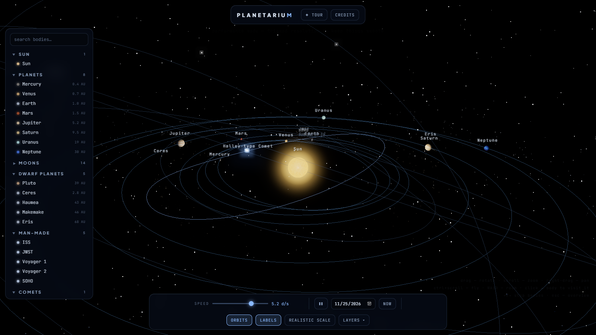

# Planetarium

A living solar system in one HTML file. Eight planets, fourteen moons, five dwarf planets, the ISS, JWST, SOHO, both Voyagers, two belts and a comet, all moving in real time.

**Live demo:** https://badmrpotatohead.github.io/planetarium/

## The physics

Every planet sits on its real elliptical, tilted orbit, computed from NASA JPL's J2000 orbital elements by solving Kepler's equation each frame. Press **NOW** and the planets are where they actually are today (within a fraction of a degree); pick any date and they move there. Inner planets whip around, Neptune crawls, and an **N-body** switch turns the rails off and lets the planets pull on each other for real.

Moon phases, the comet's timing and the spacecraft are illustrative rather than live ephemerides. The comet rides Halley's orbit but is timed to swing past the Sun shortly after you arrive.

## Run it

Open `index.html` in a browser. No build, no install, no server.

three.js loads from a CDN, so the first load needs an internet connection. Planet maps load from the `textures/` folder (or from the live demo when you open the file straight from disk, because browsers block local images in WebGL). If the maps can't load, every world falls back to a surface painted in code, and everything still works.

## Controls

- Drag to rotate, scroll to zoom, right-drag to pan, click any body to fly to it
- **Zoom slider** in the bottom bar: drag it to the left end to go all the way out to the Milky Way, or the right end to come all the way in to whatever you're looking at. The − / + buttons step on a tap and glide while held; the − and + keys do the same
- ← / → step through bodies, Esc returns to the overview, Space pauses time
- Ctrl+scroll flies forward, WASD roams
- Keep zooming out and the sky turns into the Milky Way, with a marker where the Sun sits
- Bottom bar: time speed from real time up to 1,000 days a second, date picker, orbits, labels, and **Realistic scale** (true distances, where the planets become specks)
- **Layers**: a light pulse that shows light travel time to each planet, travel times by walking, car, jet, Voyager or light, orbit trails, belts, N-body gravity, and an ambient drone
- **Tour** flies through everything on its own

`window.PLANETARIUM` in the browser console exposes the scene, camera and state if you want to poke around.

## Credits

- **Planet and Moon maps** (Mercury, Venus, Mars, Jupiter, Saturn, Uranus, Neptune, Moon): [Solar System Scope](https://www.solarsystemscope.com/textures/), based on NASA mission data, licensed [CC BY 4.0](https://creativecommons.org/licenses/by/4.0/). Included unmodified in `textures/`.
- **Earth maps** (day, night lights, clouds, normal, specular): [three.js example textures](https://github.com/mrdoob/three.js/tree/r160/examples/textures/planets), MIT License, loaded from jsDelivr pinned to three.js r160.
- **Orbital elements**: [NASA JPL Solar System Dynamics](https://ssd.jpl.nasa.gov/planets/approx_pos.html). Moon, dwarf planet and spacecraft figures from NASA fact sheets.
- **Software**: [three.js](https://threejs.org) 0.160.0 (MIT), loaded from jsDelivr. Fonts: Plus Jakarta Sans and JetBrains Mono via Google Fonts (SIL Open Font License).
- The Sun, dwarf planets, small moons, spacecraft, belts, comet, Milky Way and galaxy are all drawn in code.

The same credits are in the app under **Credits**.

## License

Code: MIT, see [LICENSE](LICENSE). The texture files in `textures/` stay under their own CC BY 4.0 license.
